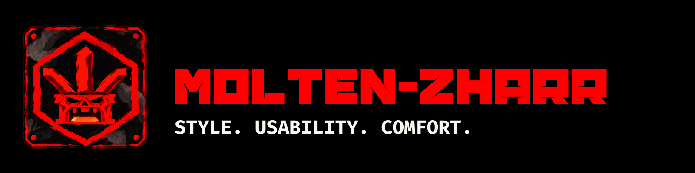
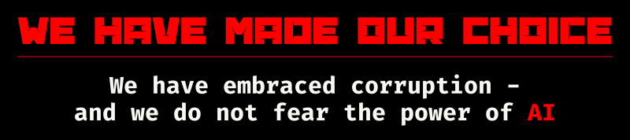

<!-- Public organization profile: molten-zharr/.github/profile/README.md. -->

[English](README.md) · [Русский](README.ru.md)

  
  
  

# 

We create applications you **WANT** to use.

Our watchword is **STYLE**.\
Our creed is **USABILITY**.\
Our choice is **COMFORT**.

We will make Linux great - and we need **YOU**.

Support our ideas and our fight against the odds!\
Join our ranks as a developer!

 

## Projects

| Project | What it does |
|---|---|
| [Almavorn](https://github.com/Molten-Zharr/Almavorn) | **Our flagship.** A Linux music player for the desktop and terminal. Your music. Your shortcuts. Your layout. |
| [Basalgrim](https://github.com/Molten-Zharr/Basalgrim) | A Linux file manager. Work with files on the desktop or in the terminal, using a mouse and keyboard. |

## Our manifesto

You should own your software and be able to customize it. Here's what we expect from our applications:

1. A stylish, beautiful interface that makes you want to try it.
2. Hints, guides, shortcut lists and visual examples inside the application.
3. Full control with a mouse, a keyboard or both.
4. Plugins you can create, install and modify.
5. Your own profiles, with freedom to change how most elements look and where they sit.
6. Updates that preserve your settings.

[Read the full manifesto](manifesto/README.md) · [Русская версия](manifesto/README.ru.md)

## People

| Member | Role |
|---|---|
| [GregulasM](https://github.com/GregulasM) | Developer |
| [Adahn](https://github.com/iamadahn) | Developer |

## Join us

Share the ideas in our [manifesto](manifesto/README.md)? Pick a project and help with code, design, translations or testing on your Linux setup. Report bugs and share ideas in that project's Issues.
